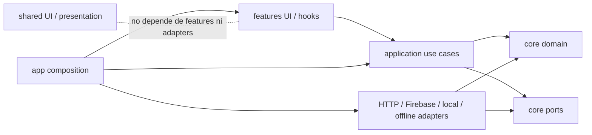

# Arquitectura objetivo

## Decisión principal

Evolucionar la arquitectura que ya existe por extracción gradual de responsabilidades. No trasladar carpetas de forma masiva ni crear capas/clases por operación trivial. Mantener el dominio compartido en `core/domain`; organizar las interfaces y los casos de uso alrededor de las funcionalidades; conservar Firebase, HTTP, IndexedDB y caché como adaptadores intercambiables; y mantener React solo en `app`, `features` y UI compartida.

Las features pueden avanzar hacia módulos verticales (`domain`, `application`, `infrastructure`, `ui`) cuando tengan modelos/reglas propios y un límite claro. No duplicar entidades compartidas como preguntas, intentos o sesiones. Las reglas comunes permanecen en `core/domain` hasta que una separación de dominio aporte cohesión real.

## Estructura orientativa

```text
src/
  app/                         # Router, providers, inicio y composición de dependencias
  core/
    domain/                    # Reglas puras y modelos de estudio compartidos
    application/               # Casos de uso independientes de framework/infraestructura
    ports/                     # Contratos que la aplicación necesita
  adapters/
    http/ firebase/ local/ offline/  # Implementaciones y mappers externos
  features/
    quiz/ cards/ stats/ ...     # UI, hooks/controllers y mappers de presentación por feature
  shared/
    ui/ presentation/ styles/   # Piezas verdaderamente compartidas; sin lógica de features
```

No crear `modules/` como contenedor duplicado mientras `features/` ya agrupe la UI. La posible evolución a `features/<name>/{domain,application,infrastructure,ui}` se hace caso a caso. Evitar directorios vacíos, `index.ts` de reexportación sin necesidad y wrappers que no oculten una complejidad real.

## Dirección de dependencias



La flecha de `adapters` hacia `ports` representa implementación del contrato: los puertos se declaran hacia dentro en `core`. `app` es el único punto que conoce simultáneamente UI, casos de uso y adaptadores. `shared` no debe alojar casos de uso, estado específico de feature ni acceso a persistencia.

Cada pantalla solicita su capacidad con `useStudyService('feature')`; el agregado tipado completo queda en la composición de `app` y no se expone a páginas. Esto mantiene un único montaje de dependencias y estrecha los tipos que puede usar cada consumidor.

## Estado

- **Estado local de pantalla:** `useState` para formularios, filtros, pestañas, diálogos privados y estados de carga de una página.
- **Estado de negocio/persistencia:** repositorios y casos de uso; las pantallas reciben snapshots ya preparados. No duplicar esto en Zustand.
- **Estado compartido de cliente:** Zustand se utiliza solo para el estado efímero compartido de diálogos/toasts, con store vanilla y selectores React. No persistir automáticamente el store ni trasladar estado de negocio. Mantener estado local en `useState` cuando alcance.
- No persistir automáticamente el store de Zustand ni guardar progreso en él. IndexedDB/local store y Firebase mantienen sus contratos actuales.

## Casos de uso y modelos

Crear casos de uso donde una operación coordine reglas de dominio, uno o más puertos, políticas de cuenta/tiempo o efectos que deban probarse por separado. Preferir funciones TS puras o funciones de fábrica, como los use cases existentes. Evitar un caso de uso por getter/setter.

Mantener distinción entre entidad/regla de dominio, DTO externo y view model. Convertir al cruzar el borde; no permitir que tipos Firebase o arrays posicionales del formato legacy lleguen a la UI o al dominio nuevo. Para los datos ya persistidos, los mappers deben aceptar formatos históricos explícitamente y conservar el comportamiento de recuperación.

## Primer módulo representativo

Propuesta: **Progreso/estadísticas**, en modo de solo lectura para la primera extracción. Ya tiene `StatsPage`, un mapper de analítica, reglas puras compartidas y una composición separada. Se puede separar la consulta/ensamblado de estadísticas detrás de un contrato y cubrirla con fixtures sin cambiar la UI ni los datos guardados. El flujo de iniciar práctica desde estadísticas permanece en la capa de coordinación de aplicación y se verifica aparte.

Esta es una propuesta para Etapa B; aquí no se ha modificado código. Si tras actualizar a `main` la revisión encuentra una dependencia nueva que haga el slice inseguro, el plan se recalibra antes de tocar producción.
