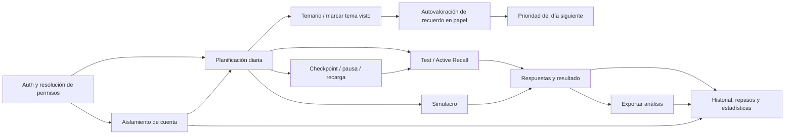

# Auditoría E2E por recorridos de usuario

## Estado integral de UX y arquitectura de información (actualizado 5 de noviembre de 2026)

Este informe reúne evidencias de la auditoría manual, Playwright y los recorridos aislados con Firebase Emulator. No representa pruebas con usuarios reales ni certificación WCAG. La aplicación y las reglas productivas no se modificaron ni se usaron para probar escrituras.

El [registro canónico de hallazgos](audit-findings.md) mantiene IDs, estados y vínculos de evidencia/pruebas para UX y Agentic Test Explorer; este informe conserva el análisis y la evidencia UX. La auditoría de requisitos de plataforma, con matriz de implementación y aceptación pendiente, está en [extreme-platform-status.md](extreme-platform-status.md). Son alcances activos; no implican que la cobertura UX o de calidad esté completa.

### Corte histórico: acceso privilegiado y primera suite E2E (4 de noviembre de 2026)

- `tai-supertest@example.test` no existía en el primer arranque de Auth Emulator `demo-tai-auth`; el fixture reservado lo creó. En las siguientes pruebas verificó el UID esperado, se restableció dentro del Emulator y se autenticó. No se consultó ni modificó Firebase de producción.
- `npm run test:e2e:supertest`: **7/7 Chromium**. El propietario sintético completó Planificación → Temario/estudio → autoevaluación → hito/test → Resultado → Progreso; navegó y recargó rutas protegidas y Accesos; aprobó y revocó una solicitud. La matriz verificó con SDK cliente permisos, aislamiento y denegaciones de Firestore. Perfiles probados: usuario aprobado, restringido, pendiente y anónimo/invitado, además del propietario.
- `tai-owner-route-smoke.yaml`: **1 escenario, 48 pasos, 16 módulos**, ejecución determinista ATE con perfil propietario y sin proveedor LLM. Abarca Planificación, Temario, Test, Simulacros/Exámenes, Progreso, Falladas, Errores, entrenamientos, Ajustes, Ayuda, Accesos y Curar vínculos. La prueba comprueba navegación, título y ausencia de error/spinner; no afirma interacción exhaustiva con cada control de esas pantallas.
- Evidencia visual autenticada persistente: [Planificación](evidence/ux-audit-2026-11-04/owner-planificacion.png), [Temario/estudio](evidence/ux-audit-2026-11-04/owner-temario-estudio.png), [Resultado](evidence/ux-audit-2026-11-04/owner-resultado.png), [Progreso](evidence/ux-audit-2026-11-04/owner-stats.png), [Curación editorial](evidence/ux-audit-2026-11-04/owner-curar-contenido.png) y [Accesos](evidence/ux-audit-2026-11-04/owner-acceso.png). El viewport de estas capturas es móvil; el banner rojo de Emulator es una advertencia de test local, no contenido de producción.
- `npm run check`: **958 aprobadas / 27 omitidas** (corte previo a los últimos cambios de test/docs). La suite completa más reciente (`npm run test:e2e:ci`) tuvo baseline **70/70** y **186 aprobadas / 66 fallidas / 16 omitidas** (268 tests). Se alineó `cards` con su redirect a Inicio; sus rutas pasan focalmente, sin actualizar snapshots. Hay 64 capturas con discrepancias visuales contra el baseline histórico y 2 timeouts WebKit del control de duración. Los 66 contextos de error y los 66 IDs de `failedTests` en `.last-run.json` confirman ese desglose. `tests/e2e-baseline.test.js` pasa **1/1** y comprueba que los snapshots del candidato se restauran incluso cuando Playwright falla; `tests/e2e/snapshots` y `dist/firebase-config.json` no presentan cambios.
- Diagnóstico WebKit (reproducido en ambos temas): `main.planning-page` ya computa `visibility:hidden` al terminar `goto('/#/planificacion')`; ocurre antes de pulsar “Mes” y rellenar la fecha. `.route-transition`, `#app`, `body` y `html` siguen visibles; el `main` no tiene `hidden`, clase `.invisible` ni estilo inline, y no hay ancestro `inert` ni `body.is-initial-loading`. La inspección CSSOM de reglas de visibilidad no encontró un selector que coincida con la cadena de ancestros. `selectOption` mantiene timeout a 30 s. La causa continúa abierta, UX-007.
- Clasificación visual: revalidación enfocada contra capturas candidatas: `routes.spec.ts` **86/86 aprobadas** en Chromium/WebKit, claro/oscuro y recorridos auxiliares. La corrida integral del runner histórico pasó baseline **70/70** y registró **188 aprobadas/66 fallidas/16 omitidas** en candidata; los 66 IDs se reconcilian con 64 deltas de screenshot y 2 timeouts WebKit. Las 64 capturas representan drift entre la rama y el commit de baseline `c81acbc…` en 16 rutas. La comparación visual cubrió Accesos, Errores, Exámenes/Simulacros, Lectura, Quiz/Resultado, Simulacro Parte 2, Progreso, Temario, Test, Inicio, Ajustes, Falladas, Relámpago y Trampas. Las diferencias observadas corresponden a la reorganización CSS y a mejoras/cambios documentados de contenido/acciones; las capturas candidatas vigentes pasan. Se actualizaron selectivamente 20 snapshots de cinco rutas que aún no reflejaban su UI actual; pasaron 20/20 en rerun. `test:e2e:ci` seguirá informando drift hasta actualizar la referencia histórica en un commit revisado; los timeouts UX-007 siguen siendo fallos reales abiertos.
- Limitaciones abiertas: clasificar las discrepancias visuales restantes y capturas WebKit; cerrar causalidad del timeout; verificación manual restante de WCAG 2.2 AA; más casos autenticados de interrupción/concurrencia/token expirado/offline; análisis interactivo de todos los controles por rol; cuota Gemini 429. La auditoría sigue **abierta**.

### Inventario comprobado

La tabla de rutas canónicas está en `src/shared/navigation/paths.ts`; el router y sus guardas, en `src/app/router/route-runtime.tsx`. La navegación principal observada en `WorkspaceNavigation.tsx` expone Inicio, Planificación, Temas estudiados, Test por tema, Simulacros, Preguntas falladas, Progreso, tres entrenamientos y Tu espacio (Ayuda, Ajustes y Accesos para propietario). El menú móvil añade Sesión rápida, Repaso de fallos y Errores del banco. Las rutas internas incluyen Quiz, Resultado, revisión de simulacro y exámenes; Tarjetas conserva la ruta histórica pero redirige a Inicio en esta versión. Curación de contenido es una ruta owner-only; no se publicó contenido. La Ayuda reúne instrucciones.

| Área | Pantallas/funciones conectadas | Estado que sí se comprobó |
|---|---|---|
| Inicio y planificación | Inicio, sesión rápida, sesión diaria, agenda semanal/mensual, horizonte, eventos y propuestas | Sesión configurada, pausa y reanudación por reload en E2E local; el journey sintético autenticado completa Planificación → estudio → resultado → progreso en Emulator. La planificación diaria usa preferencias y temas vistos; no se valida efecto educativo. |
| Temario y materiales | catálogo de temas vistos, referencias de índice/material, cobertura, autoevaluación y seguimientos diferidos | Abrir material se distingue de leer/cubrir; cobertura no se presenta como comprensión. Recorrido autenticado sintético y E2E de materiales; elección de PDF es local al dispositivo. |
| Preguntas | configuración Test, Quiz, corrección/explicaciones, confianza, marcas, resultado, revisión e historial | Ciclo de respuesta y recuperación local probado en Chromium/WebKit; resultado y lectura autenticada de documentos de Emulator comprobados en Chromium. |
| Repaso y hábitos | falladas/racha, repaso espaciado, Lectura atenta, Detective de trampas, Relámpago; tarjetas ocultas de la interfaz actual | Flujos locales verificados; cobertura de tarjetas solo corresponde a estado legado/pruebas donde la función aún está disponible. No afirmar que Tarjetas sea accesible desde la navegación actual. |
| Simulacros | selección/configuración, Parte 1/Parte 2, examen, quiz, pausa/abandono, resultado, revisión e historial | Recorrido local de fin, abandono/reanudación y corrección E2E. Persistencia remota del resultado de simulacro no certificada. |
| Progreso y calidad | Progreso, gráficas, informe de estrategia, Errores del banco | Gráficas con datos, estado vacío y reflow verificados; errores locales revisables. No se comprobó envío externo de un aviso. |
| Cuenta y PWA | Accesos, permisos, recuperación, sincronización, importación/exportación, actualización, shell offline, Ayuda | Permisos e aislamiento con usuarios `.test` en `demo-tai-auth`; shell/ayuda offline verificados. No se certifican offline combinado con actividad autenticada, token expirado, dispositivo físico ni sincronización de producción. |

### Mapas de arquitectura de información

**Arquitectura vigente observada en la rama (navegación lateral):**

```text
Inicio
├─ Planificar: Temas estudiados, Planificación
├─ Practicar: Test por tema, Simulacros
├─ Seguimiento: Preguntas falladas, Progreso
├─ Entrenamientos: Lectura atenta, Detective de trampas, Relámpago
└─ Tu espacio: Ayuda, Ajustes, Accesos (propietario)
```

En móvil, el Menú ofrece además Sesión rápida, Repaso de fallos y Errores del banco, que no son destinos permanentes de la barra inferior. Curar vínculos a epígrafes es una ruta owner-only enlazada desde Ajustes; no se anuncia como destino de estudio.

**Arquitectura anterior detectada y propuesta aplicada a navegación lateral y menú móvil:**

```text
Inicio
├─ Planificar: Planificación, Temas estudiados
├─ Practicar: Test por tema, Simulacros (más Sesión rápida en Menú)
├─ Entrenamientos: Lectura atenta, Detective de trampas, Relámpago
├─ Seguimiento: Preguntas falladas, Progreso (más Errores del banco en Menú)
└─ Tu espacio / La app: Ayuda, Ajustes, Accesos (propietario)
```

Cambio de bajo riesgo aplicado en `WorkspaceNavigation.tsx` y `study-menu-composition.ts`: unifica “Planificar” y “Seguimiento”, mueve Temas estudiados al grupo de planificación y elimina el acceso duplicado a Planificación en el diálogo móvil. Rutas, deep links, permisos y acciones permanecen iguales. El impacto esperado es reducir búsquedas y cambios de categoría para empezar el día o preparar temas; no se midió con usuarios ni se cuantifican segundos ahorrados.

### Recorridos completos: alcance actual

| Flujo | Evidencia | Resultado y límite |
|---|---|---|
| A. Empezar el día | Journey autenticado sintético Chromium/Emulator; E2E local de sesión diaria, pausa, reload y siguiente actividad | Pasa desde autenticación, permiso, planificación, actividad, evaluación/preguntas, resultado y progreso. WebKit Auth se omite por configuración. No se verificó una cuenta personal ni el cambio de fecha con sincronización real. |
| B. Tema nuevo | E2E de material recomendado e inicio de práctica; journey de Emulator incluye tema y autoevaluación | Pasa en local y Chromium sintético; referencias de academia son borradores/catalogación y no equivalen a currículo oficial validado. |
| C. Active Recall/espaciada | E2E de paso sin tarjetas con fallback, recuerdo en papel y prioridad diferida; recuperación de quiz | Pasa en Chromium/WebKit local y Chromium Emulator. FSRS/timing se prueba como regla de software, no como eficacia pedagógica. |
| D. Test/simulacro | Práctica, corrección, resultado, pausa/reload y simulacro interrumpido/reanudado en E2E | Pasa localmente, incluidos estados terminales. El guardado remoto y los permisos de simulacro se verificaron solo donde lo cubre el journey sintético; no en todas sus modalidades. |
| E. Progreso | Estadísticas, gráficos, filtros, vacío y reflow; Emulator verifica progreso tras el journey | Pasa en Chromium/WebKit local y Chromium sintético. No demuestra mejora de aprendizaje longitudinal. |
| F. Interrupciones | atrás/adelante, reload, pagehide, checkpoints, pausa, error de escritura/reintento y shell offline | Varios casos pasan localmente. Interrupción autenticada offline, token caducado y concurrencia entre pestañas/dispositivos siguen sin combinarse en un mismo journey. |

Los automatismos prueban número de pasos, estados y duración técnica, pero no tiempo humano, decisiones percibidas ni comprensión. No se registró una línea base comparable antes/después de la nueva agrupación.

### Heurísticas, carga cognitiva y accesibilidad

Hallazgos sustentados por navegación observada, código, recorridos y capturas; severidad orientativa (P0–P3):

| Prioridad / heurística | Evidencia y efecto | Acción / aceptación |
|---|---|---|
| P1 · Consistencia, reconocimiento, information scent | Escritorio y menú móvil agrupaban los mismos destinos de forma distinta; Planificación estaba bajo “Afianzar”. Aumenta búsqueda y cambio mental de categoría. | Aplicar agrupamiento unificado. Aceptación: ambos modos presentan los mismos grupos/nombres y mantienen enlaces correctos. Implementación hecha; pruebas focalizadas pendientes en este corte. |
| P1 · Estado visible / prevención de error | Sesión manual de Ajustes mostró “sincronizado” junto a `permission-denied`; la observación no permite atribuirlo a un documento/servicio. La recepción de datos podía ocultar error de escritura. | UI de sincronización ya separa recepción y error de escritura, con reintento. Aceptación: escritura fallida nunca se presenta como confirmada. Pruebas locales de error/reintento registradas; Emulator no acredita backend productivo. |
| P1 · Control y recuperación | En auditoría anterior, recargar ruta protegida durante Auth podía perder destino o quedar en carga; prueba determinista reprodujo y corrigió deadlock de bootstrap y navegación cancelada al cerrar sesión. | Corregido en cambios locales y journey Auth Chromium. Aceptación: recarga conserva ruta tras resolver permiso; logout termina en Inicio y no filtra datos entre UIDs. WebKit Auth omitido. |
| P1 · Orientación en navegación móvil | La captura móvil de `/#/falladas` mostraba Inicio resaltado aunque el usuario estaba en Preguntas falladas. `useActiveSection` asignaba `falladas: 'home'`, en desacuerdo con su agrupación actual bajo Seguimiento. | Corregido a `stats` para mantener activo Progreso/Seguimiento. Regresión Vitest y E2E en Chromium y WebKit verifican `aria-current="page"` en Progreso y ausencia de estado activo en Inicio. |
| P2 · Correspondencia y carga cognitiva | La etiqueta del propósito diario podía prometer “tema nuevo” sin actividad `newContent`; la sesión mostraba una secuencia cuyo primer paso Active Recall podía no tener tarjetas. | Propósito derivado de la agenda efectiva y fallback a preguntas para temas vistos. Pruebas locales del checkpoint; no inferir aprendizaje por cumplir actividad. |
| P2 · Feedback y recuperación | Se observaron estados de explicación que no distinguían falta confirmada de fallo de carga; texto de resumen de tarjeta podía no reflejar “Dudaba”. | Estados de explicación y copys se aclararon en cambios previos. Persisten límites de procedencia y textos de explicación dependientes del contenido. |
| P2 · Flexibilidad, Fitts y contexto | Planificación, material, test y repaso son funciones separadas; pero los enlaces de actividad pueden conducir a configuración genérica o a flujo contextual. Pruebas semánticas comprueban las rutas principales; no hay conteo de decisiones de usuario. | Reducir salto de contexto solo cuando el vínculo conserve `trainingSessionId` y actividad. Aceptación: iniciar desde planificación completa el paso del mismo checkpoint una sola vez. |
| P3 · Minimalismo / Gestalt | Progreso contiene secciones largas; en móvil están plegadas y el reflow con texto máximo cabe en viewports probados. | Mantener divulgación progresiva; no eliminar métricas sin validar semántica. |
| P2 · Jerarquía y espacio móvil (UX-010) | Las capturas WebKit de Relámpago muestran el icono de título encima del texto: la utilidad `inline-feature-icon` no anulaba el `display:block` global de SVG. | Corregido con `display:inline-block`; E2E en Chromium/WebKit a 393 px confirma que el icono y el título comparten línea en Relámpago y Detective de trampas. |

Evaluación WCAG 2.2 AA parcial: E2E verifica enlace “Saltar al contenido”, foco de encabezado al navegar, menú modal con Tab/Shift+Tab, navegación de teclado, estados `aria-current`/`aria-pressed`, movimiento reducido, reflow con texto ampliado y algunos estados `role=status/alert`. No se hizo auditoría manual completa de lector de pantalla, contraste de todos los estados, zoom 400%, tablet real, voz ni cumplimiento de cada criterio. No se declara conformidad WCAG.

### Revisión de implementación y verificación de este corte

- Navegación lateral y menú general armonizados en las categorías “Planificar” y “Seguimiento”; prueba de composición actualizada. No se cambian rutas ni contratos persistentes.
- Evidencias visuales: snapshots de todas las rutas en `tests/e2e/snapshots/{chromium-darwin,webkit-darwin}/`; baseline visual `npm run test:e2e:ci` regeneró temporalmente salidas locales y se restauraron las capturas que modificó esta ejecución.
- En el rerun completo más reciente (antes de corregir la expectativa `cards`): fase baseline **70/70 aprobada**; suite general **182 aprobadas / 70 fallidas / 16 omitidas**. Desglose: **64 comparaciones de captura** (16 pantallas × 2 temas × 2 motores), **4 expectativas de ruta** de `cards` y **2 timeouts WebKit** de reprogramación. Los casos de `cards` esperaban “Tarjetas de repaso”, pero la ruta redirige a Inicio; después se alineó la expectativa con el comportamiento y pasó **4/4** entre motores/temas. Los dos timeouts reaparecieron en WebKit claro/oscuro; las trazas ubican el fallo en `selectOption` con `visibility:hidden` en `main.planning-page`; no se aisló la regla/estado. El test Emulator de siete casos se ejecuta por separado.
- `npm run check` después del ajuste: arquitectura, ESLint, TypeScript; **957 aprobadas / 27 omitidas**. E2E focal de menú, foco y teclado: **4/4 Chromium/WebKit**. `npm run build`: completó; conserva avisos conocidos de Zod/Rollup y chunks grandes. `npm run test:e2e:supertest`: **7/7 Chromium** en Emulator en la ejecución documentada del mismo día. `npm run test:e2e:firebase-auth`: **1 Chromium aprobada / 1 WebKit omitida**. No se contactó producción.
- No se actualizan snapshots visuales en masa: las diferencias requieren revisión por pantalla antes de aceptar un baseline nuevo.

### Pendientes para cerrar una auditoría integral

1. Cerrado: ejecutar pruebas focales de los dos menús y validar foco por teclado tras el cambio de agrupación (4/4 Chromium/WebKit).
2. Revisar visualmente el resto de las capturas WebKit/otros viewports. El rerun histórico de Chromium para `routes.spec.ts` dio **35/43 aprobadas**: seis diferencias de captura (Inicio, Ajustes y Falladas, tema claro/oscuro) y dos expectativas obsoletas de `cards` (ya corregidas y validadas 4/4). Se preservaron 18 PNG de las diferencias iniciales y 12 PNG de cuatro pantallas WebKit; no se tocaron snapshots. El rerun integral más reciente produjo 64 parejas con diferencias contra el baseline histórico; hay que seguir clasificando cambios intencionales frente a regresiones sin aceptar snapshots en masa.
3. Aislar el timeout WebKit de `selectOption` en planificación y decidir si la corrección es de producto o del test; el rerun ya confirmó que es reproducible para tema claro y oscuro.
4. Repetir cobertura extensa con Gemini cuando recupere cuota; la misión del 4/11 terminó parcial por 429 y no cubrió todas las rutas/cuentas.
5. Completar pruebas combinadas de expiración de token, offline autenticado, escritura fallida y concurrencia; validar zoom 400%, contraste completo, teclado y lector de pantalla manual.
6. Repetir sesiones de navegador con un entorno de prueba persistente claramente identificado para resultados visibles en pantallas restringidas y datos de varias cuentas.

**Corte:** 4 de noviembre de 2026. **Entorno:** Playwright sobre TAI local, usuarios ficticios y proyecto Firebase de demostración `demo-tai-auth`; Auth Emulator en `127.0.0.1:9099` y Firestore Emulator en `127.0.0.1:8080`. No se usaron cuentas ni datos de producción. Firebase CLI avisa que las llamadas a servicios no emulados de un proyecto `demo-*` fallan; los tests autenticados además bloquean solicitudes del navegador fuera de loopback y los recursos GET estáticos del popup OAuth.

## Mapa de recorridos y dependencias



El mapa se basa en rutas reales de `route-runtime.tsx`, controles y adaptadores Firebase, estado local por cuenta y las llamadas de continuidad entre planificación, temario, test, resultado y estadísticas. Las funcionalidades que no existen como operación directa en el repositorio no se cuentan como cobertura: por ejemplo, interrupción y reanudación de simulacros no tiene aquí una prueba autenticada completa; la reanudación verificada corresponde a tests/checkpoints.

## Matriz de recorridos y estados

| Recorrido / dependencias | Variantes y transiciones de riesgo | Ejecutado y resultado | Estado final observado | Defectos / riesgos pendientes |
|---|---|---|---|---|
| Inicio de sesión → acceso completo → Planificación → tema nuevo → marcar estudiado → autoevaluación en papel → día siguiente → logout/login. Depende de Auth, permiso Firestore, horario, temas vistos y `trainingRecall`. | Normal; recarga; día simulado; cambio de cuenta; logout/login; persistencia local y remota. | Chromium + Firebase Emulator: inicialmente pasó; tras acotar el comando y volver a ejecutar, **falla al recargar `/planificacion`**, antes de comprobar el siguiente día. | Los documentos `users/{uid}/cfg/trainingRecall`, `training` y `seen` existen y contienen la autoevaluación; tras recarga la app acaba en Inicio aunque la sesión sigue en Auth Emulator. | Defecto confirmado de guard durante restauración/permisos. Se corrigió la ruta protegida para esperar `accessResolved`; typecheck y suite de unidad pasan, pero la repetición E2E quedó bloqueada por puertos emulados ocupados. Prioridad crítica: confirmar redirección/continuidad tras reload. |
| Planificación → actividad nueva o test prioritario/variado → quiz → resultado → siguiente paso. Depende de enfoque semanal, orden de academia, temas vistos y sesión diaria. | Tema nuevo configurado/no configurado; repetición de actividad; paso siguiente; atrás/adelante; planificación con uno o varios temas. | Chromium y WebKit: 3 pruebas de planificación/pausa/recuerdo por navegador; todas pasaron en los reruns focalizados. | Ruta final observada es `/quiz` con referencias `dailyTraining`, `trainingSessionId` y `trainingActivityId`; sesión diaria avanza al paso siguiente. | Las expectativas antiguas de `/temario` o `/cards` se actualizaron a la navegación real. El fallo original que esperaba prioridad en índice fijo se sustituyó por selector semántico. Falta repetir la suite completa después de los cambios. |
| Estudio por papel → recordar parcialmente → próxima revisión. Depende de `paper-recall-assessment`, cuenta activa y fecha local. | Día siguiente; recarga; repetición/corrección de autovaloración; cambio de cuenta. | Caso cubierto por el test Auth, pero su aserción de planificación no alcanzó el estado por la redirección durante reload. Prueba de interfaz local de recall pasó en Chromium y WebKit. | Autoevaluación persistida local y en Firestore Emulator; el orden/título de la siguiente actividad aún no está verificado de principio a fin en Auth Emulator. | No declarar correcto el enlace entre la valoración y el test prioritario hasta repetir Auth E2E. No se debe asumir posición ordinal de la actividad: la agenda añade/ordena actividades dinámicamente. |
| Responder test → resultado → historial/estadísticas. Depende de motor de sesión, persistencia de respuestas, scoring y sincronización. | Cambiar respuesta; navegar; recargar en mitad; pausa; finalizar; volver a abrir estadísticas. | Chromium: journey Auth supertest **6/6** en ejecución dedicada; recorre planificación, estudio, autovaloración, hito de tres preguntas, resultado, estadísticas/rutas y controles de permisos. | Resultado real creado desde UI; documentos de recall y attempt sessions observados en Firestore Emulator con cliente autenticado. | No incluye todas las rutas de resultado/explicaciones ni reanudar un simulacro; ampliar después de cerrar el fallo de reload. |
| Simulacro → respuestas → resultado → historial. Depende de selector de examen, motor/scoring y persistencia. | Selección, navegación y cierre normal; repetición y abandono. | No hay un recorrido autenticado completo contabilizado en este corte. Hay tests E2E locales previos para inicio/resultados de simulación; no se consideraron evidencia de persistencia remota. | No se certifica estado remoto de puntuación/historial en este flujo. | Pendiente: respuesta cambiada, interrupción/reanudación si existe, scoring, explicaciones y estadísticas encadenadas.
| Temas vistos → estadísticas → filtros → logout/login y cambio de cuenta. Depende de estado local por UID, progreso y permisos. | Marcar varios; alternar cuentas; navegación directa a rutas restringidas. | Chromium: matrix Auth supertest 6/6 incluye roles propietario, aprobado, restringido, pendiente y anónimo; tests de cliente prueban aislamiento y denegaciones. | El propietario ve progreso propio; otros roles se redirigen; escrituras fuera de reglas se deniegan en Emulator. | La prueba de cambio de cuenta del archivo auth se interrumpió antes del segundo login por el defecto de reload. Aislamiento directo probado en otras pruebas de la suite dedicada.
| Pausa de test / reload / reanudación. Depende de `pendingRun`, local storage/IndexedDB y motor de quiz. | Pausar/reanudar; recarga; navegación de retorno. | Chromium y WebKit: caso focal de pausa pasó en ambos navegadores. E2E de `bridge.spec.ts` pagehide/reload pasó en Chromium. | La misma pregunta/sesión vuelve a abrirse y el checkpoint conserva avance; progreso final verificado por la prueba de bridge. | Casos de offline y caducidad real de Auth durante intento siguen pendientes en un recorrido combinado.
| Historial de intentos → exportación manual → borrado detallado. Depende de sesiones, intentos, partes ZIP y progreso agregado. | Construir exportación; inspeccionar contenido; borrar historial y mantener progreso. | Chromium: los dos recorridos de exportación actualizados pasan. Descargan el ZIP y leen manifiesto, informe y parte JSON reales con `fflate`. | Se validan nombres de entrada, 10 intentos, estados, tamaño y que borrar intentos/eventos no borra estadísticas agregadas. | Es flujo local de exportación; aún falta encadenar un resultado autenticado remoto con exportación tras logout/login.
| Permisos Firebase y aislamiento entre identidades. Depende de reglas de `firestore.rules` y scopes UID. | Propietario, normal/aprobado, restringido, pendiente, anónimo; escrituras inválidas, escalada y acceso cruzado. | Chromium: `npm run test:e2e:supertest` **6/6**, proyecto `demo-tai-auth`, Auth y Firestore Emulator. | Rutas y datos por UID; escrituras no permitidas denegadas por reglas. El test incluye llamadas de cliente reales y lectura remota autenticada. | No sustituye despliegue/validación de reglas productivas; no se realizó ni debía realizarse. |
| ATE adversarial y navegación autenticada. Depende de Playwright de ATE, usuario sintético, guard de red y, para descubrimiento adaptativo, cuota Gemini. | Rutas fuera de alcance, controles repetidos, reload, cuentas/permisos y estados interrumpidos; hipótesis requieren reproducción determinista. | La preparación de identidad con IndexedDB y acceso owner se verificó en Emulator. Una misión LLM anterior se ejecutó en tres pasadas y terminó parcial por 429. El nuevo batch determinista de rutas completó **48/48 pasos**, cero llamadas de modelo. | El batch comprueba encabezado/estado de página de 16 módulos; el viaje Supertest además modifica datos sintéticos con la UI y cubre Firestore/access. No constituye auditoría de interacción completa de todas las pantallas. | Siguen pendientes expiración de token, concurrencia y desconexión autenticada, y expansión de interacciones por módulo. La cuota Gemini sigue agotada; no se reinvocó. |

## Variantes adversariales cubiertas y no cubiertas

Cubiertas por recorridos focales: repetición de acciones (dos clics para acciones de estudio y selección); reload durante quiz; pausa/reanudación; atrás/adelante en E2E locales; cambio de cuenta y UID; acceso directo con seis roles; reglas Firestore y escrituras inválidas; completar y volver a exportar datos existentes.

Pendientes para una cobertura fiable: desconexión y recuperación en el mismo journey autenticado; expiración forzada del token durante una actividad; dos pestañas modificando el mismo calendario/actividad; doble envío concurrente de autoevaluación/repaso; valores de calendario fuera de rango enlazados con planificación; reanudación tras error de escritura y tras cambio de cuenta durante una promesa. No se afirma cubrir todas las permutaciones. La matriz de permisos y los pasos de mayor impacto se priorizaron con cobertura de estados/transiciones; la pareja cuenta × nivel de permiso × ruta se ejercitó en la matrix supertest. La generación basada en modelos queda para expandir una vez que el flujo autenticado de reload vuelva a pasar.

## Hallazgos y correcciones

1. **Confirmado — la ruta protegida se perdía al restaurar Auth tras reload.** `ReactScreen` interpretaba `full=false` como denegación antes de que `onAuthStateChanged` y el listener de acceso de Firestore concluyeran; redirigía `/planificacion` a `/home`. Se añadió `accessResolved` al estado de sincronización, se resuelve explícitamente para propietario, denegación, cierre de sesión, errores y configuración ausente, y las rutas protegidas muestran carga mientras se determina el acceso. Se agregó el escenario de recarga al journey Auth existente. **Verificación:** typecheck y `npm run check` pasan; Auth E2E previo al arreglo reproducía el defecto. Falta rerun E2E posterior al arreglo porque ya había un proceso ATE usando los tres puertos requeridos.
2. **Corregido — el script Auth Emulator recogía specs supertest por una expresión `--grep` demasiado amplia.** Se acotó a `tests/e2e/auth-emulator.spec.ts`. La repetición aislada hizo visible el defecto anterior de reload.
3. **Corregido — expectativas obsoletas de exportación.** La interfaz actual descarga un ZIP completo, no ficheros independientes; ahora se prueban los archivos reales del ZIP, sin debilitar el contenido comprobado.
4. **Corregido — expectativas obsoletas de planificación.** Las pruebas ya no asumen una posición fija o una ruta anterior al redirect al quiz; buscan la actividad por contenido semántico y esperan la ruta final observada.

## Validación de este corte

- `npm run check`: arquitectura, lint, lint de exclusiones, typecheck y **954 tests aprobados / 27 omitidos**.
- `npm run test:e2e:supertest`: **6/6** en Chromium, Auth/Firestore Emulator.
- Recorridos focales de plan/pausa/recuerdo: **3/3 Chromium y 3/3 WebKit**.
- Exportación por ZIP: **2/2 Chromium**.
- Auth Emulator: el comando corregido ahora solo selecciona su archivo. Antes de la corrección de ruta, su rerun reprodujo el defecto de recarga; **pendiente repetición posterior a la corrección**.
- Suite E2E completa del corte anterior: **223/264 pasaron, 27 fallaron, 14 omitidas**. Varias eran expectativas obsoletas o snapshots distintos; esta cuenta es anterior a los ajustes recientes y no se presenta como estado final. No se volvió a lanzar porque el proceso ATE ya tenía ocupados los puertos requeridos.
- La auditoría no se declara completa: falta cerrar el rerun Auth post-fix, ejecutar el conjunto E2E actualizado, completar variantes adversariales de sesión/concurrencia/offline y resolver si se autoriza el envío de capturas al proveedor de ATE.

## Actualización posterior de Explorer y cierre del journey Auth (2026-11-04)

La autorización Gemini fue concedida y la exploración se ejecutó; quedó parcial por tres rechazos de cuota. El [informe de revisión](explorer-mission-2026-11-04.md) contiene las cintas, candidatos descartados y límites. La reproducción posterior encontró y corrigió la espera circular introducida al aguardar permisos de la ruta antes de arrancar Auth, y la carrera del shell que cancelaba la navegación de logout. Se mantienen los cambios de resolución de permisos descritos arriba. Tras los ajustes: journey Auth **1 passed Chromium / 1 WebKit skipped**, supertest **7/7 Chromium**, `npm run check` **957 passed / 27 skipped**. La suite E2E general de 264 combinaciones y las variantes adversariales restantes no se dan por completadas.

## Revalidación posterior

- Los resultados anteriores de `npm run check` (957 aprobadas / 27 omitidas), `npm run test:e2e:supertest` (7/7 Chromium) y `npm run test:e2e:firebase-auth` (1 Chromium aprobada / WebKit omitida) son evidencia del corte anterior, no una repetición de esta sesión.
- La repetición actual de `npm run test:e2e:firebase-auth` no llegó a iniciar Firebase Emulator: `npx` necesitó `firebase-tools@13.35.1` y npm falló con `ENOTFOUND registry.npmjs.org`. No hay CLI local ni emuladores activos; no se inició ninguna conexión a producción.
- La repetición de `npm run test:e2e` tampoco arrancó. El puerto 4187 estaba ocupado por una ejecución Playwright separada de `tests/e2e/routes.spec.ts --update-snapshots`, servida desde un directorio temporal de baseline. Se identificó y se dejó intacta para no interferir con esa ejecución. El puerto no aceptaba conexiones HTTP, por lo que no se podía reutilizar.
- Por tanto, esta sesión no añade un resultado nuevo de aprobado/fallido para Auth ni para la suite general: la revalidación está bloqueada por disponibilidad local y red. Repetir cuando termine el proceso de snapshots y `firebase-tools` esté disponible localmente o npm responda.

## Actualización de infraestructura Agentic Test Explorer (2026-11-04)

Se añadió al ATE 0.2.0 ejecución de escenarios por lotes con Playwright determinista, caché de planes, presupuesto y contabilidad de tokens, backoff 429/503, tres perfiles, semillas y artefactos por paso. La reproducción usa cero llamadas de modelo. El generador de escenarios acepta un archivo de solicitud, llama una vez por plan nuevo y cachea solo el plan; nunca cachea los resultados del navegador. TAI añadió reglas permanentes de emulator-only y el brief de journeys completos en `tests/e2e/missions/tai-full-journeys-request.md`.

**Revalidación observada:** la suite ATE pasó **128 pruebas y omitió 5**. La lista de TAI contiene **266 tests en 17 archivos**. El último Playwright `.last-run.json` registra **2 fallos**: el mismo test de programa/reprogramación del repaso en papel excedió 30 s en WebKit con temas claro y oscuro. Ambos traces/error-contexts muestran Planificación y el control “Revisar propuesta”; no se aisló aún la causa. No se atribuye a la integración de Firebase ni se presenta como test aprobado. Auth Emulator no pudo iniciarse porque `npx` no pudo resolver `registry.npmjs.org` (`ENOTFOUND`); no hubo acceso a producción.

**Consumo Gemini:** no existen métricas históricas verificables de tokens para comparar antes/después. La nueva instrumentación permitirá medir futuras ejecuciones; por ahora no se afirma un porcentaje de ahorro. El modo Gemini todavía depende de cuota disponible; los planes guardados pueden reproducirse sin modelo.

**Límite de alcance (actualizado):** no se lanzó otra tanda Gemini por cuota 429. La misión determinista de rutas y el journey Supertest autenticado sí se ejecutaron en Emulator, según la revalidación más reciente al inicio del informe. El brief `tai-full-journeys-request.md` propone recorridos para expansión; su existencia no demuestra ejecución completa. Mantener abierta la auditoría hasta repetir la suite E2E integral tras los ajustes, clasificar diferencias visuales, resolver o explicar el timeout WebKit y ampliar escenarios adversariales/a11y.

## Seguimiento del control de Planificación (2026-11-04)

Se simplificó el formulario «Programar un repaso»: el campo Actividad ofrecía una única opción (“Test por tema”), así que ahora se presenta como valor informativo. El dominio sigue guardando `topicTest`; no cambian reglas de capacidad, fecha, tema visto, duración, propuesta de confirmación ni persistencia. Se actualizó el journey para comprobar el valor visible, no seleccionar una opción única.

**Evidencia de verificación:** el recorrido de crear, confirmar, revisar lista, recargar, reprogramar, confirmar, volver a recargar y abrir el test pasó en Chromium con tema claro y oscuro (**2/2**). `npm run check` pasó arquitectura, lint, typecheck y **957 tests aprobados / 27 omitidos**. `npm run build` también pasó; conserva las advertencias conocidas de anotaciones de Zod y chunk Firebase de más de 500 kB. No se repitió la suite E2E total tras este cambio.

**WebKit pendiente:** el journey sigue fallando antes de poder operar el selector de duración. La captura diagnóstica muestra `main.planning-page` y el control con `visibility:hidden`, mientras `.route-transition`, sus ancestros, `body` y `html` computan `visible`; el `main` no tiene estilo inline. El `body` ya no contiene `is-initial-loading` y `#initial-loading` ya fue retirado. Una búsqueda de reglas top-level que coincidan directamente con el `main` no encontró una regla de visibilidad; no se inspeccionaron todavía reglas anidadas ni el cascade completo. No se cambió el timeout ni se simuló una interacción. El recorrido WebKit permanece fallido y el origen de la regla/estado sigue sin aislar.

La matriz completa previa al ajuste de `cards` terminó **182 aprobadas / 70 fallidas / 16 omitidas**. Sus salidas temporales se perdieron al iniciar una ejecución Playwright posterior, que limpia `test-results`; por tanto, no se enlazan aquí. Se regeneró `routes.spec.ts` en Chromium solamente: **35 aprobadas / 8 fallidas** (seis diferencias de captura en Inicio, Ajustes y Falladas, para claro/oscuro; dos títulos esperados de `cards`). Las 18 PNG actual/expected/diff generadas se preservaron en el repositorio. Las capturas de Falladas confirman el arreglo del estado activo móvil: la referencia histórica resalta Inicio y la captura actual resalta Progreso. En Inicio, la referencia muestra “Tarjetas pendientes” donde la UI actual presenta “Temas estudiados”; Ajustes añade el enlace owner-only “Curar vínculos a epígrafes”. Son diferencias de contenido/jerarquía que requieren revisión de producto, no aceptación automática de snapshots. Esta ejecución focal no cubre WebKit ni sustituye a la suite completa. En la reejecución posterior al ajuste, Playwright reportó **186/66/16**; se conservan 64 discrepancias de captura y 2 timeouts WebKit. La exploración Gemini sigue parcial por cuota 429. La auditoría general permanece abierta.

### Parejas visuales muestreadas

| Ruta | Referencia histórica | Captura actual |
|---|---|---|
| Inicio claro | [expected](evidence/ux-audit-2026-11-04/home-light-expected.png) | [actual](evidence/ux-audit-2026-11-04/home-light-actual.png) | [diff](evidence/ux-audit-2026-11-04/home-light-diff.png) |
| Inicio oscuro | [expected](evidence/ux-audit-2026-11-04/home-dark-expected.png) | [actual](evidence/ux-audit-2026-11-04/home-dark-actual.png) | [diff](evidence/ux-audit-2026-11-04/home-dark-diff.png) |
| Ajustes claro | [expected](evidence/ux-audit-2026-11-04/settings-light-expected.png) | [actual](evidence/ux-audit-2026-11-04/settings-light-actual.png) | [diff](evidence/ux-audit-2026-11-04/settings-light-diff.png) |
| Ajustes oscuro | [expected](evidence/ux-audit-2026-11-04/settings-dark-expected.png) | [actual](evidence/ux-audit-2026-11-04/settings-dark-actual.png) | [diff](evidence/ux-audit-2026-11-04/settings-dark-diff.png) |
| Falladas claro | [expected](evidence/ux-audit-2026-11-04/falladas-light-expected.png) | [actual](evidence/ux-audit-2026-11-04/falladas-light-actual.png) | [diff](evidence/ux-audit-2026-11-04/falladas-light-diff.png) |
| Falladas oscuro | [expected](evidence/ux-audit-2026-11-04/falladas-dark-expected.png) | [actual](evidence/ux-audit-2026-11-04/falladas-dark-actual.png) | [diff](evidence/ux-audit-2026-11-04/falladas-dark-diff.png) |

Las capturas preservadas son evidencia de la ejecución focal Chromium del 4/11; no sustituyen las referencias versionadas ni representan el estado de WebKit.

## Revalidación y cierre parcial de hallazgos (5 de noviembre de 2026)

El código de referencia y las pruebas E2E actuales se revalidaron después de las correcciones pendientes. Este corte sustituye las anotaciones anteriores sobre UX-007, el inventario owner y el número de tests Supertest; no convierte en completas las partes de la auditoría que no se pudieron observar.

| Hallazgo/área | Evidencia nueva | Estado y límite |
|---|---|---|
| UX-007 · Planificación WebKit | La regresión de primer render pasó **4/4** en Chromium/WebKit y light/dark. El flujo de programar, confirmar, recargar y reprogramar pasó **8/8**. `routes.spec.ts` terminó **86/86**. Se difieren dos frames la retirada del gate inicial en `InitialAppLoadingProvider`; el timeout original no cambió. Capturas resultantes en `evidence/ux-audit-2026-11-04/planning-visible-*`. | **CORREGIDO Y VERIFICADO** para navegadores/tamaños de estos escenarios. Mecanismo local consistente con el caso de estilos obsoletos de WebKit descrito por [Bugzilla 326092](https://bugs.webkit.org/show_bug.cgi?id=326092). |
| UX-009 · Accesibilidad | Árbol ARIA owner: 16 rutas en escritorio y Home/Planificación móvil; **312 controles**, sin nombres vacíos. Navegación/enfoque y diálogo móvil con Escape/foco restaurado. Pruebas `mobile-layout`, `react-pages`, `stats-charts`: **30/30** Chromium/WebKit. Capturas de escritorio, móvil, menú y recorridos recientes; checklist en [`accessibility-manual-review.md`](accessibility-manual-review.md). | **ANALIZADO / abierto**. No se ha operado lector de pantalla real, zoom real 200%/400%, revisión exhaustiva de contraste ni criterio por criterio WCAG de toda la aplicación; no se declara conformidad AA. |
| UX-011 · Foco de menú en WebKit | El E2E EXTREME abrió el menú por puntero y cerró con Escape. Chromium restauró foco; WebKit lo dejó en `body`. Se enfocan explícitamente los disparadores antes de abrir el diálogo. | **CORREGIDO Y VERIFICADO**: 1.000 acciones (500 aperturas y cierres) pasó en Chromium y WebKit; Escape devuelve foco al mismo botón. |
| ATE-005 · Descubrimiento de controles | Revalidación más reciente de `npm run test:e2e:supertest`: **12/12** en Auth/Firestore Emulator y perfiles sintéticos. Añade recuperación autenticada tras pagehide/reload: checkpoint del UID owner, avance 2/3 y respuesta previa se restauran; salida cierra como sesión interrumpida. Capturas `evidence/accessibility-2026-11-05/authenticated-run-*.png`. | **EN CORRECCIÓN**. Se verifican más estados dinámicos, pero no todos los controles tras interacciones ni todas las relaciones entre módulos; quedan formularios/modales y journeys adversariales longitudinales por recorrer. |
| ATE-006 · Perfiles CI | QUICK en PR; INTENSIVE programado/manual; EXTREME manual con repetición Playwright determinista de 1.000 acciones. Artefactos configurados a 14 días. EXTREME local: **2/2**. | **Implementado localmente, remoto no verificado**: la rama `ac71bea` está publicada; `gh run list` no encontró runs y GitHub devolvió 404 al despachar `e2e-profiles.yml` porque todavía no existe en la rama por defecto. Requiere integrar el workflow antes de comprobar Actions. |

### Cobertura observada del inventario sintético

El perfil propietario llegó a 16 rutas (Inicio, Temario, Planificación, Errores, Falladas, Relámpago, Trampas, Lectura, Curación de contenido, Test, Simulacro, Simulacro Parte 2, Estadísticas, Ayuda, Ajustes y Accesos), y a dos rutas a 375×812. Los otros perfiles validaron el acceso directo a las doce rutas protegidas y la ausencia de controles owner en Accesos. Esto comprueba permisos y nombres ARIA observados, pero no demuestra que cada acción visible complete su operación de negocio.

Conteo del árbol accesible por ruta en el estado inicial de owner (roles interactivos con nombre; no es un porcentaje de cobertura):

| Ruta | 1280×900 | 375×812 |
|---|---:|---:|
| Inicio | 13 | 14 |
| Temario | 44 | — |
| Planificación | 17 | 17 |
| Errores | 4 | — |
| Falladas | 1 | — |
| Relámpago | 5 | — |
| Trampas | 10 | — |
| Lectura | 3 | — |
| Curar contenido | 5 | — |
| Test | 32 | — |
| Simulacro | 18 | — |
| Simulacro Parte 2 | 3 | — |
| Estadísticas | 45 | — |
| Ayuda | 19 | — |
| Ajustes | 59 | — |
| Accesos | 3 | — |

El árbol completo con roles, nombres y cajas se conserva en `evidence/accessibility-2026-11-05/owner-route-control-inventory.json`.

### Matriz de interacción observada por ruta (ATE-005)

La cifra cuenta roles interactivos con nombre accesible en el estado inicial (281 escritorio + 31 en Home/Planificación móvil = 312). No existe instrumentación que mida controles únicos activados entre todas las pruebas; la tabla enumera interacciones demostradas y no presenta porcentajes inventados.

| Ruta | Controles iniciales desktop | Interacción/estado dinámico demostrado | Brecha no cubierta sistemáticamente |
|---|---:|---|---|
| Inicio | 13 | Menú, navegación y sesión rápida (`bridge`, `routes`, `home-auth-loading`). | No se midió cada CTA; usuario nuevo y owner en todos los vacíos. |
| Temario | 44 | Abrir tema/material, marcar sección, filtro y autoevaluación (`routes`, `react-pages`, `supertest-emulator`). | No se recorren todos los temas, formatos y controles de contenido largo. |
| Planificación | 17 | Iniciar sesión, agendas semanal/mensual, evento/hito, reprogramación, confirmación y recarga (`css-ui`, `routes`, `bridge`, `supertest-emulator`). | Combinaciones de preferencias/fechas y fallos de guardado por control. |
| Errores | 4 | Revisar y reabrir avisos locales (`errors-page`). | Cada categoría y estado adverso de sincronización. |
| Falladas | 1 | Vacío → ayuda contextual `repaso`; pregunta fallada sintética → búsqueda/no coincidencia, filtros de tema/temario/racha, marca guardada tras reload y práctica de la pregunta. Contador accesible «1 pregunta»; reflow sin scroll horizontal a 320 px y objetivo de marca ≥24×24 CSS px. Chromium/WebKit, 320/1440 px (`failures-empty-state-journey`, 8/8). El componente cubre error→Reintentar→recuperación (3/3). | Historial extenso y persistencia remota/multiusuario sin cobertura sistemática. |
| Relámpago | 5 | Responder y avanzar (`bridge`). | Repetición rápida, red interrumpida y todos los estados de resultado. |
| Trampas | 10 | Reflujo con etiquetas largas (`css-ui`). | Ejercicio funcional de cada control y combinación de respuesta. |
| Lectura | 3 | Flujo de tres pasos, selección de palabras, bloqueo temporal, respuesta, avance y salida con confirmación (`supertest-emulator`, 11/11, Chromium/Emulator). Captura: `evidence/accessibility-2026-11-05/reading-options-timed-gate.png`. | No se recorre el lote completo de preguntas, interrupción/recuperación ni todas las respuestas límite. |
| Curar contenido | 5 | Carga de opciones, filtro vacío/restauración y gate de evidencia; un fixture sintético pasa el formulario, se serializa al borrador local y sobrevive a reload (`supertest-emulator`, 11/11, Chromium/Emulator). Capturas: `evidence/accessibility-2026-11-05/content-curation-filter-empty.png` y `content-curation-synthetic-draft.png`. | El fixture “aprobado” es artificial y no acredita revisión documental. No se cubren importación/exportación ni eliminación de vínculo. |
| Test | 32 | Configuración, preguntas, marcas, pendientes, corrección, historial y test en papel (`bridge`, `routes`, `paper-test-log`, `supertest-emulator`). | No todos los selectores ni estados de fallo remoto. |
| Simulacro | 18 | Empezar, pausar, abandonar, reanudar y corregir al finalizar (`bridge`). | Variantes de examen y persistencia remota no cubiertas por cada control. |
| Simulacro Parte 2 | 3 | Entrada/render y flujo relacionado (`routes`, `bridge`). | Sin aserción independiente para todos los controles propios de Parte 2. |
| Estadísticas | 45 | Gráficos con datos/vacíos, reflujo y secciones móviles plegables; la comparación A/B cambia de **+10 / −10** al invertir los intentos. La evolución mantiene métrica, filtro T1.02, periodo de 8 semanas y tabla visible tras recargar. Desde “Practicar temas” llega a Test, selecciona T1.02 y abre una pregunta real en Quiz con sus cuatro respuestas. Chromium/WebKit, claro/oscuro y 320/1440 px (`stats-charts`, `stats-practice-journey`, `mobile-layout`, `css-ui`). Evidencias: `stats-comparison-reversed.png`, `stats-evolution-preferences-restored.png` y capturas inicial/desplazada `stats-to-topic-test-*`. | Cada filtro/cálculo de visualización no tiene aserciones exhaustivas; las pruebas usan sesiones sintéticas locales y no acreditan cálculo de historial remoto sincronizado. La última respuesta requiere desplazamiento en la pregunta de prueba, pero se alcanza por encima de la barra de navegación. |
| Ayuda | 19 | Índice, anclas, destinos y disponibilidad offline (`help-icons`, `bridge`). | No se recorre cada artículo/enlace en todos los perfiles. |
| Ajustes | 59 | Horario semanal, evento/hito y preferencias usadas por Planificación (`css-ui`, `supertest-emulator`). | Todos los valores posibles y guardado con red perdida. |
| Accesos | 3 | Owner aprueba/revoca; perfiles normal/restricted/pending/anonymous verifican guardas (`supertest-emulator`). | No se probaron sesiones paralelas/cambio rápido de usuario por control. |
| Simulacros · configuración | 13 | En viewport 320 px cambia 40/80 preguntas y límites de duración, alcance, origen y Parte 2; comprueba `aria-pressed`/checkbox, protección frente a cero orígenes, persistencia tras reload y ausencia de overflow (`bridge.spec.ts`, Chromium/WebKit 2/2). Capturas antes/después en `evidence/accessibility-2026-11-05/simulation-config-{,restored-}320px-{chromium,webkit}.png`. | Configuración válida cubierta; no se inicia el simulacro en este recorrido ni se recorren todos los filtros de exámenes/historial o fallos de carga. |

La matriz localiza la evidencia existente y las brechas; **ATE-005 sigue abierto** hasta asociar control→acción→resultado, abrir los estados dinámicos relevantes y completar los journeys longitudinales/adversariales restantes.

El journey owner añade Planificación → estudio de tema → autoevaluación → test/hito → resultado, comprobación de historial remoto sintético, navegación/recarga de rutas y alta/baja de acceso. Firestore Emulator denegó escrituras no permitidas; todas las llamadas estuvieron limitadas al proyecto `demo-tai-auth`. No se usó Firebase de producción ni Gemini.

### Cambios de regresión y próximos pasos

- `InitialAppLoadingProvider` conserva el gate de carga dos ciclos de `requestAnimationFrame`, con guardas de doble programación y cleanup de callbacks. La regresión comprueba visibilidad real de Planificación y uso del calendario mensual/duración en Chromium y WebKit.
- El inventario recorre el árbol ARIA como lista y ahora exige controles por ruta; una aserción anterior aceptaba erróneamente inventarios vacíos y se corrigió antes de registrar el conteo de 312.
- El menú móvil superó 1.000 acciones en Chromium, comprobando cada transición abierto/cerrado y el foco tras Escape. Es un estrés seguro de navegación; no pretende probar persistencia de dominio.
- El primer test de EXTREME mostró una diferencia de foco en WebKit al abrir el diálogo con puntero; tras enfocar el activador explícitamente, las 1.000 acciones pasan tanto en Chromium como WebKit. El hallazgo queda registrado como UX-011.
- La suite completa reveló una expectativa antigua que esperaba `topicTest` cuando el propio fixture genera `newContent`; la ruta observada a Temario coincidía con el plan mostrado y sus identificadores. Se corrigió solo el oráculo E2E y se registró como ATE-008.
- QUICK/INTENSIVE/EXTREME están configurados en workflows distintos a deploy; el upload conserva test-results, trazas, screenshots y evidencias por 14 días. La rama `ac71bea` se publicó, pero no se abrió PR. `gh workflow list` muestra solo los workflows de default branch y el dispatch manual de `e2e-profiles.yml` devolvió 404 porque aún no está integrado allí; no se afirma ejecución remota.
- Verificación final del corte anterior: `npm run check` **189 archivos aprobados / 1 omitido; 959 tests aprobados / 27 omitidos**; build correcta (advertencias de anotaciones Zod y chunks >500 kB); E2E global **260 pasadas, 18 omitidas, 0 fallidas** en Chromium/WebKit, 9,9 min; Supertest Emulator **8/8** entonces; EXTREME **2/2** con 1.000 acciones por motor. La revalidación actual posterior amplía Supertest a **11/11**; incluye los tres journeys añadidos descritos abajo. Los workflows pasaron parseo YAML y los archivos de configuración/pruebas Prettier en el corte anterior. El whitespace señalado por `git diff --cached --check` pertenecía a trabajo preexistente staged y se preservó.
- Pendientes que impiden el cierre total: UX-009 requiere lector de pantalla real, zoom de navegador 200%/400%, contraste exhaustivo y revisión criterio por criterio; ATE-005 aún no asocia cada control dinámico/formulario/modal a un oráculo funcional ni cubre todos los recorridos longitudinales/adversariales; ATE-006 requiere integrar el workflow en default branch y ejecutar GitHub Actions (la feature branch está publicada, sin PR). No se accedió a Firebase de producción ni se consumió Gemini.

### ATE-005 — ampliación verificada de controles dinámicos (5 de noviembre de 2026)

- `npm run test:e2e:supertest` terminó **11/11** en `demo-tai-auth` con perfiles sintéticos; el owner recorre Lectura atenta y Curación de contenido, y se conservan capturas.
- Lectura: los tres pasos funcionan, se marca una palabra, la autoevaluación respeta la espera mínima, el usuario responde, avanza a la siguiente pregunta y sale mediante confirmación. El reloj se instala antes del primer arranque porque la composición captura la función `Date.now` al inicializar.
- Curación: se cargan opciones del tema, se mantiene la selección al filtrar una cola vacía y el botón de borrador sigue desactivado sin evidencia. Un segundo caso usa un fixture textual explícitamente sintético, valida el gate de formulario, persiste un vínculo local y verifica su round-trip tras reload. El caso no coteja los PDF ni representa una revisión de verdad; no publica ni sincroniza cambios curatoriales.
- Regresión detectada en la primera ejecución: reloj instalado tras bootstrap no controlaba la referencia `Date.now` ya capturada; dos selectores ambiguos causaban falsos fallos. Se ajustó únicamente el fixture/oráculo y la reejecución pasó. No se cambió comportamiento de producto.
- ATE-005 permanece **EN CORRECCIÓN**: estas rutas y estados concretos ya tienen evidencia, pero no equivalen a cobertura exhaustiva de todos los módulos, controles, import/export/borrado curatorial, cambios de usuario concurrentes ni fallos de red.

### Recuperación de una sesión autenticada (5 de noviembre de 2026)

- **Recorrido:** el owner sintético marca T1.02 como visto desde Planificación, crea un hito de tres preguntas, responde una y avanza a la segunda. Antes de recargar, la prueba valida `tai.run:tai-supertest` con `idx = 1` y respuesta guardada; `page.reload()` dispara el flujo de `pagehide`.
- **Reanudación:** el diálogo identifica el hito y anuncia `2/3`; al elegir «Continuar», vuelve a `/quiz`, presenta la pregunta 2 y conserva IDs, índice y respuesta previa. Al salir, Resultado registra la sesión interrumpida y el checkpoint se elimina.
- **Evidencia visual:** [`antes de recargar`](evidence/accessibility-2026-11-05/authenticated-run-before-reload.png), [`diálogo de recuperación`](evidence/accessibility-2026-11-05/authenticated-run-resume-prompt.png), [`sesión reanudada`](evidence/accessibility-2026-11-05/authenticated-run-resumed.png). Capturas sintéticas verificadas visualmente. El almacenamiento es local; este test no representa sincronización multidispositivo.
- **Verificación:** `npm run test:e2e:supertest` pasó **12/12** en Chromium con Auth/Firestore Emulator `demo-tai-auth`. La interacción de estudio y el abandono se hacen por la UI; no se alteraron reglas ni comportamiento pedagógico.
- **Pendiente ATE-005:** cambios de cuenta/expiración, concurrencia entre pestañas, pérdida de red, historial extenso y los controles dinámicos restantes requieren journeys y oráculos propios.

### Comparación de simulacros en Estadísticas (5 de noviembre de 2026)

- En un fixture local sintético con resultados 70 y 80, el test selecciona 70 como Intento A y 80 como Intento B y verifica `Nota: +10`; invierte ambos selectores y comprueba `Nota: -10`. Esto valida la operación visible y el sentido de la comparación sin alterar el cálculo de producto.
- **Verificación:** `npm run test:e2e -- tests/e2e/stats-charts.spec.ts` pasó **8/8** entre Chromium/WebKit, temas claro/oscuro y viewports 320/1440 px. La suite mantiene cobertura de gráfica, tooltip, teclado, reflujo y estado vacío.
- **Evidencia:** [`comparación invertida`](evidence/accessibility-2026-11-05/stats-comparison-reversed.png), con datos sintéticos locales; no hay lectura ni escritura Firebase en este caso.
- **Límite:** sigue faltando recorrer exhaustivamente filtros de temas/tipos, periodos, estrategia y datos sincronizados; ATE-005 permanece abierto.

### Persistencia de preferencias de evolución en Estadísticas (5 de noviembre de 2026)

- En el fixture sintético local, la persona cambia la métrica a «Tiempo por pregunta», elige 8 semanas y activa «Ver tabla». Tras recargar, abre Evolución y se comprueba que la métrica, el periodo y la tabla siguen seleccionados/renderizados.
- También vuelve a «Acierto», filtra por T1.02 y recarga una segunda vez: se conserva el tema y el selector vuelve habilitado, verificando que el modo de tiempo no destruyó el filtro.
- **Verificación:** `npm run test:e2e -- tests/e2e/stats-charts.spec.ts` pasó **8/8** en Chromium y WebKit; abarca claro/oscuro y viewports de 320/1440 px. La semilla local solo se inserta cuando no existe `tai.v1:guest`, para que `addInitScript` no restablezca la fixture durante reload y destruya el estado que se pretende verificar.
- **Evidencia:** [`preferencias restauradas`](evidence/accessibility-2026-11-05/stats-evolution-preferences-restored.png), capturada tras la recarga en viewport escritorio y tema claro.
- La primera ejecución falló porque el propio setup del test sobreescribía el snapshot en cada recarga. Se corrigió la condición de semillado; la evidencia no indicó un defecto de persistencia de TAI. El origen del falso fallo y su corrección están conservados en la prueba.
- **Límite:** es una comprobación de persistencia local del perfil invitado sintético; no verifica sincronización multiusuario ni todas las combinaciones de filtro/periodo. ATE-005 permanece abierto.

### Estadísticas → práctica por tema → pregunta (5 de noviembre de 2026)

- **Recorrido:** el usuario abre Progreso, elige «Practicar temas», llega a Test por tema, selecciona T1.02, activa «Empezar» y llega a Quiz. Se verifican la ruta final, el tema de la pregunta, el enunciado y las cuatro opciones.
- **Geometría/recuperación visual:** en 320 y 1440 px, Chromium y WebKit, la última opción queda por debajo de la zona visible inicial; la prueba la desplaza y comprueba que su borde inferior queda por encima de la barra fija de navegación. No se ha contado el contenido recortado por el viewport como pérdida ni se ha ocultado la barra.
- **Verificación:** `npm run test:e2e -- tests/e2e/stats-practice-journey.spec.ts` pasó **4/4**; fixture local sintético, sin llamadas Firebase ni datos remotos. Capturas inicial y tras desplazar: `stats-to-topic-test-initial-320px.png`, `stats-to-topic-test-readable-option-320px.png`, `stats-to-topic-test-initial-1440px.png` y `stats-to-topic-test-readable-option-1440px.png`.
- **Límite:** el journey llega a la pregunta, pero no la responde ni finaliza el test. La finalización y persistencia del resultado tienen pruebas separadas. ATE-005 continúa abierto para los restantes vínculos, filtros y estados adversariales.

### Falladas vacías/pobladas → ayuda, filtros, persistencia y práctica (5 de noviembre de 2026)

- **Recorrido vacío:** perfil invitado sintético sin historial abre `#/falladas`, reconoce el mensaje vacío y activa el enlace de ayuda; llega a `#/ayuda?tema=repaso`.
- **Recorrido poblado:** fixture local con una pregunta fallada; búsqueda/no coincidencia, filtros T1.02/pendiente/racha 0, marca «Repasada en el temario», reload y verificación de persistencia, filtro repasada y comienzo de práctica de esa misma pregunta.
- **Defecto UX-012 encontrado y corregido:** el anuncio decía «1 preguntas»; ahora muestra «1 pregunta» para un único resultado. No cambian filtros ni reglas de progreso.
- **Verificación:** `npm run test:e2e -- tests/e2e/failures-empty-state-journey.spec.ts` pasó **8/8** en Chromium/WebKit, viewports 320/1440; la secuencia poblada pasó 4/4 y repetición Chromium para evidencias 2/2. `tests/failures-page.test.js` pasó **3/3**, incluyendo carga fallida y recuperación después de pulsar Reintentar. El caso poblado no presenta overflow horizontal a 320 px y la etiqueta de repaso ofrece un objetivo de al menos 24×24 CSS px. Sin Firebase/Gemini. La semilla local solo ocurre si falta `tai.v1:guest`, para no borrar el estado bajo prueba en reload.
- **Evidencias visuales revisadas:** `evidence/accessibility-2026-11-05/failures-{empty,help}-{320px,1440px}.png`, `failures-populated-{320px,1440px}.png`, `failures-reviewed-restored-{320px,1440px}.png`.
- **Límite:** la recuperación se verifica a nivel de componente; no se afirma una caída de red E2E. Historial extenso y persistencia remota/multiusuario siguen pendientes; ATE-005 continúa EN CORRECCIÓN.

### Actualización ATE-005/UX-009 — error de carga y reflow de Falladas (5 de noviembre de 2026)

- **Ciclo de recuperación:** `tests/failures-page.test.js` hace que `loadQuestions()` rechace una vez y devuelva una pregunta en el segundo intento. Verifica el mensaje de error semántico, el control «Reintentar», la nueva llamada y la pregunta recuperada: **2/2**.
- **Responsive y objetivo:** el journey E2E poblado se ejecuta en Chromium/WebKit a 320 y 1440 CSS px; comprueba `documentElement.scrollWidth ≤ viewport width` a 320 y mide que el label clicable de «Repasada en el temario» supera 24×24 CSS px.
- **Evidencia:** capturas poblada y persistida revisadas: `evidence/accessibility-2026-11-05/failures-populated-{320px,1440px}.png` y `failures-reviewed-restored-{320px,1440px}.png`.
- **Límite:** es una verificación de estos controles/estados, no una inspección WCAG exhaustiva. VoiceOver/NVDA, zoom nativo 200%/400%, contraste integral, pantallas restantes y sincronización remota siguen fuera de la evidencia local; UX-009 queda abierto y ATE-005 permanece EN CORRECCIÓN.

### Reflow automatizado de rutas (5 de noviembre de 2026)

- Se amplió `tests/e2e/routes.spec.ts`: cada uno de los 18 destinos, en tema claro y oscuro, comprueba que el documento no excede el viewport a 320 y 640 CSS px. La prueba conserva sus capturas a tamaño original y ejecuta ambos motores.
- **Verificación:** `npm run test:e2e -- tests/e2e/routes.spec.ts` pasó **86/86** en Chromium y WebKit (incluye journeys adicionales de la suite). No se detectó overflow horizontal en las aserciones añadidas. Se guardan capturas de Planificación a 320/640 CSS px por motor en `evidence/accessibility-2026-11-05/planning-reflow-*`.
- **Alcance:** son anchos de viewport CSS; 640 px no demuestra zoom nativo al 200%. Tampoco se infiere ausencia universal de clipping vertical, solapamiento, contraste insuficiente o barreras con lector de pantalla.
- ATE-005 gana comprobación de reflow reproducible para rutas iniciales; la asociación de todos los controles dinámicos con resultados observables sigue incompleta. UX-009 permanece abierto.

### Configuración del simulacro: transiciones y persistencia (5 de noviembre de 2026)

- El fixture invitado local abre Simulacros → Completo a 320 CSS px. La prueba cambia el número de preguntas y observa la regla de duración mínima en las transiciones relevantes; cambia alcance, origen y Parte 2; intenta desactivar la última fuente y comprueba que TAI conserva una selección válida.
- Tras recargar, se verifican los estados accesibles y valores persistidos de todos los controles, ausencia de overflow horizontal y errores de consola vacíos. No se comienza una prueba ni se escriben datos remotos.
- **Verificación:** `npm run test:e2e -- tests/e2e/bridge.spec.ts --grep 'configuración del simulacro'` pasó **2/2** Chromium/WebKit. Capturas antes y después de recargar revisadas visualmente en `evidence/accessibility-2026-11-05/simulation-config-*-320px-*.png`.
- En una primera ejecución, el oráculo esperaba que 120 minutos se redujeran automáticamente a 90 al seleccionar 80 preguntas. El código conserva 120, opción válida; se corrigió el escenario para probar la regla real (60→80 sube a 90), sin cambio de producto.
- ATE-005 suma un conjunto de estados dinámicos cubiertos; sigue abierto para los filtros de examen, los formularios/modales restantes y las variantes adversariales que aún no tienen oráculo.

## Estado operativo vigente — 5 de noviembre de 2026

- UX-007 continúa cerrado según sus regresiones previas en Chromium/WebKit; este corte no lo reabre.
- UX-012 quedó **CORREGIDO Y VERIFICADO**; el diff de producto solo afecta al singular/plural del contador de Falladas. El test de página verifica también el camino de error y recuperación.
- ATE-005 avanza con controles poblados de Falladas, persistencia tras reload, acción de práctica, recuperación de error y mediciones responsive. Esto amplía, pero no completa, la cobertura total de rutas/controladores.
- Verificaciones vigentes de este corte: Playwright Falladas **8/8**, Vitest componente Falladas **2/2**, `npm run check` **960 aprobadas/27 omitidas**. Capturas se conservan en `evidence/accessibility-2026-11-05/`.
- Reflow de 18 destinos: `npm run test:e2e -- tests/e2e/routes.spec.ts` **86/86** Chromium/WebKit; cada ruta/tema mide overflow a 320 y 640 CSS px.
- Configuración Simulacros: `bridge.spec.ts --grep 'configuración del simulacro'` **2/2** Chromium/WebKit, con selección accesible y persistencia tras reload a 320 px.
- Verificación posterior de la suite que contiene el nuevo recorrido: `npm run test:e2e -- tests/e2e/bridge.spec.ts` pasó **48/48** Chromium/WebKit. `npm run check` pasó arquitectura, ESLint, TypeScript y Vitest: **960 aprobados/27 omitidos** (189 archivos aprobados/1 omitido); se conserva el aviso conocido de `window.scrollTo` en jsdom.
- Regresión global posterior con la nueva prueba incluida: `npm run test:e2e` pasó **272/300**, omitió 28 (10 de Emulator + 2 EXTREME por motor) y no tuvo fallos en Chromium/WebKit; duración 9,9 min. Los recorridos de Emulator (12/12) y EXTREME (2/2, 1.000 acciones por motor) se ejecutaron por separado y permanecen como evidencia vigente del mismo corte.
- UX-009 sigue abierto: se verificó teclado y algunos estados ARIA con browser automatizado, así como reflow y un objetivo táctil de Falladas; siguen sin realizarse lector de pantalla real, zoom nativo 200%/400%, contraste exhaustivo y revisión WCAG completa.
- ATE-006 sigue sin ejecución remota observable; la rama aún no ha llegado al default branch y no se creó una PR en este corte. QUICK/INTENSIVE/EXTREME permanecen disponibles localmente; EXTREME no se ejecuta en cada PR.
- Regresión global después de la ampliación: `npm run test:e2e` terminó en **270 pasadas/28 omitidas/0 fallidas** en Chromium/WebKit (298 planificadas, 9,8 min). La prueba autenticada de Emulator se ejecutó aparte y pasó **12/12**; las dos EXTREME se ejecutaron aparte y pasaron **2/2** con 1.000 acciones por motor. `npm run check` pasó con **960 aprobadas/27 omitidas** (189 archivos aprobados/1 omitido); persiste el aviso conocido `window.scrollTo` de jsdom en Cards.
